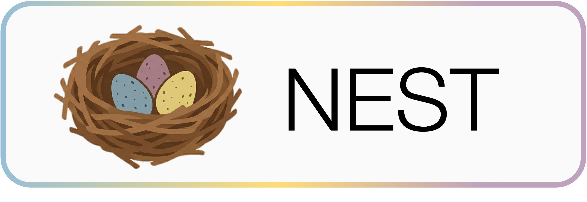
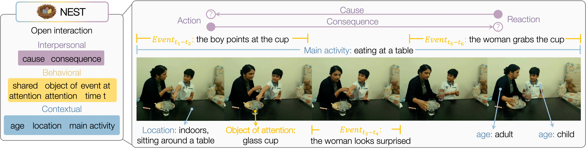

<p align="center">
  
</p>

[](https://laubravo.github.io/nest_website/)
[](https://huggingface.co/datasets/mahuynh/NEST)

Official evaluation code for **Before Words, Beyond Speech: Evaluating Nonverbal Social Reasoning in Early Childhood**, published in the **NeurIPS 2026 Evaluations and Datasets Track** as a **✨Spotlight✨**.

NEST (**N**aturalistic **E**arly-childhood **S**ocial in**T**eractions) is the first child-centric benchmark for compositional nonverbal social reasoning. Annotations are released on HuggingFace at
[mahuynh/NEST](https://huggingface.co/datasets/mahuynh/NEST). The dataset is gated, so request access on the dataset page before running the code.

<p align="center">
  
</p>

## Dataset version

This code uses **NEST v2**: 12,183 questions over 1,052 segments.

## Installation

```bash
bash setup_env.sh
conda activate nest
```

## Documentation

- [`docs/DATA.md`](docs/DATA.md): download the full-length source videos and cut them into the per-segment clips under `data/`.
- [`docs/EVALUATION.md`](docs/EVALUATION.md): run evaluations on the benchmark.

## Citation

## License

The **code** in this repository is released under the [MIT License](LICENSE). The MIT License covers only the code. It does not cover the data.

The **data** is covered by its own licenses:

- **NEST annotations and metadata** ([mahuynh/NEST](https://huggingface.co/datasets/mahuynh/NEST)): [CC BY-NC-SA 4.0](https://creativecommons.org/licenses/by-nc-sa/4.0/) (Creative Commons Attribution-NonCommercial-ShareAlike 4.0 International).
- **Source videos**: not redistributed. They keep the licenses of their original corpora: the CHILDES / TalkBank terms of use, and the YouTube Terms of Service for ChildPlay segments.
